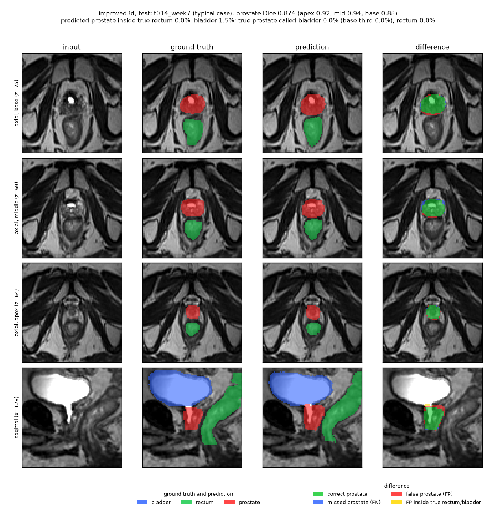
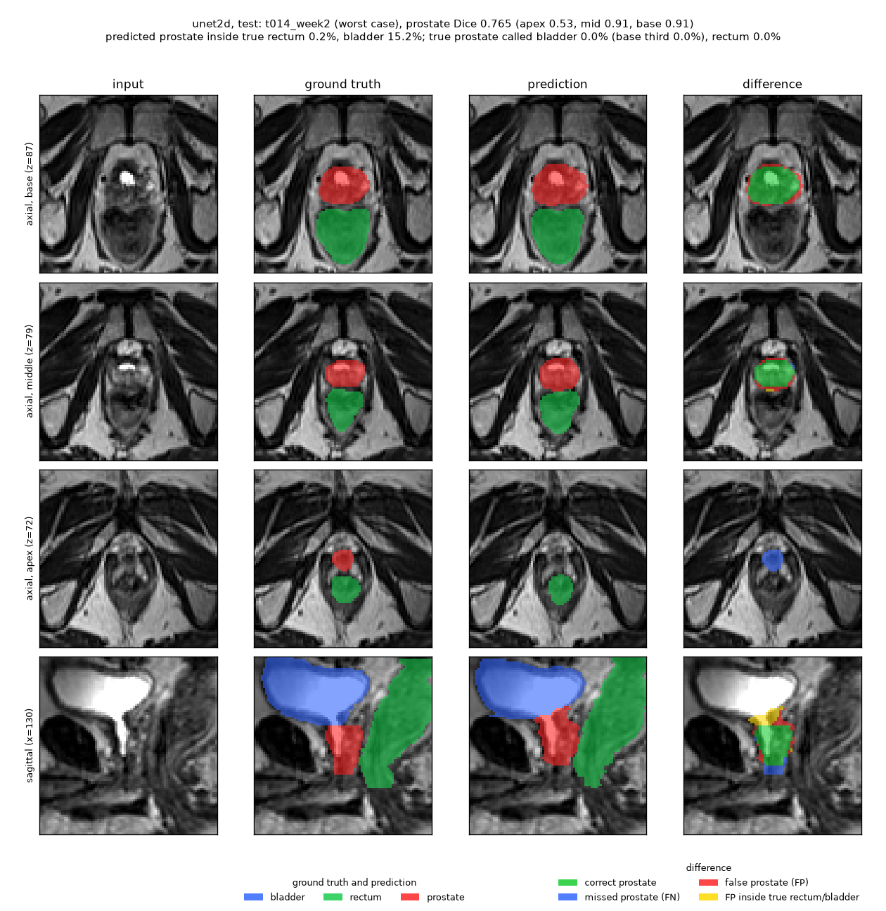
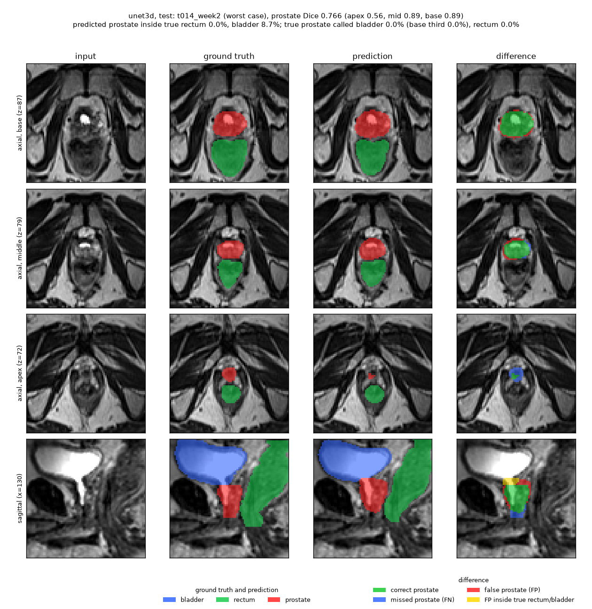
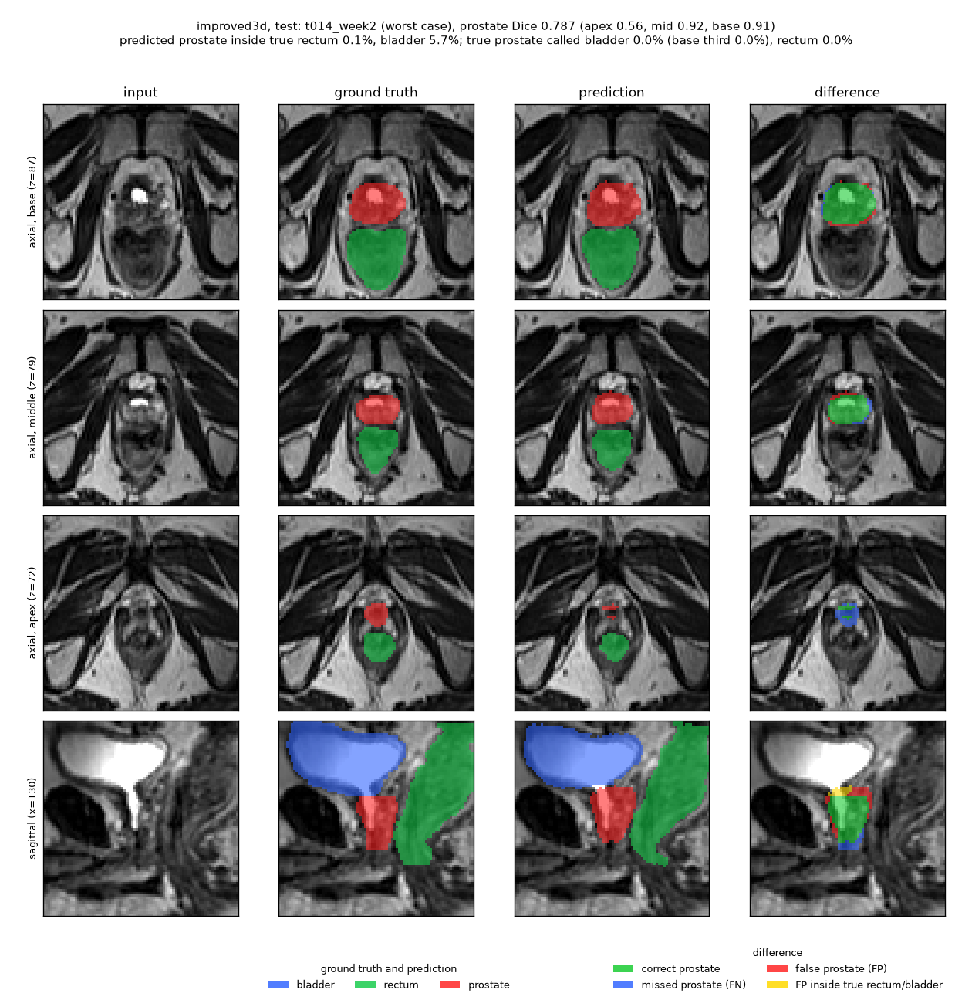
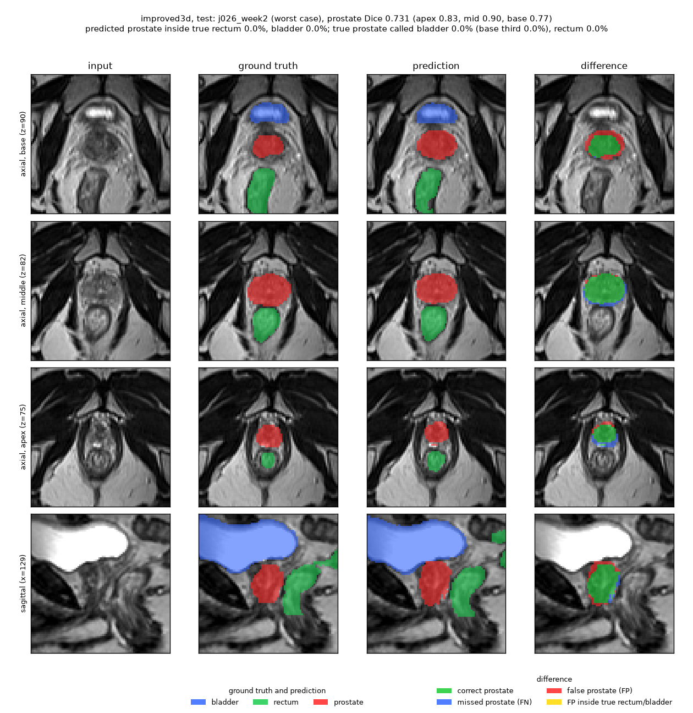
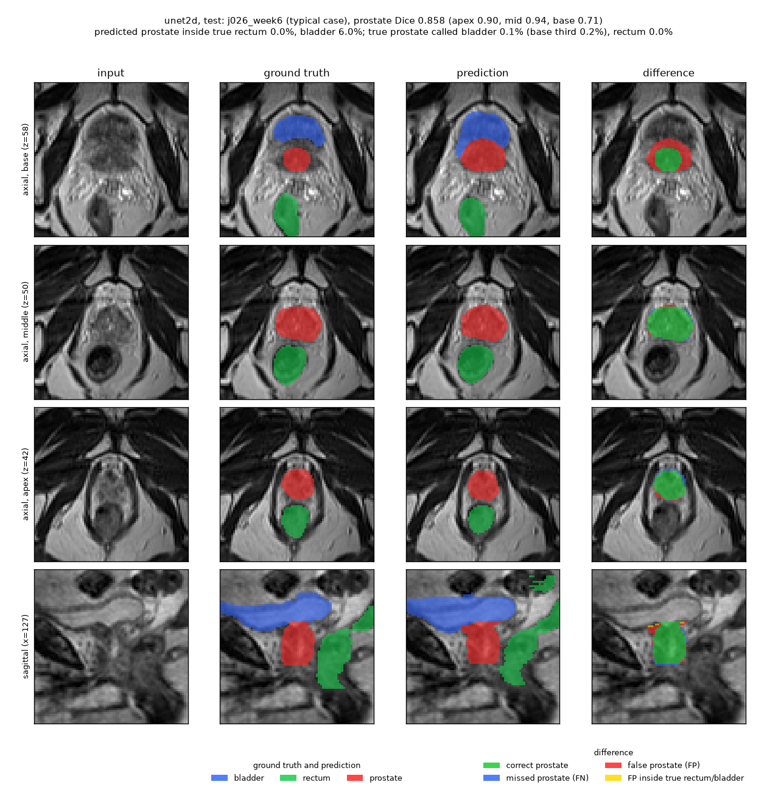

# 3D Improved U-Net for HipMRI Prostate Segmentation

COMP3710 Report 2026, Segmentation project 2.2 (Hard difficulty). Student: s4906217.

> **Draft status.** All experiments are finished and the held-out test split was evaluated once, after the protocol
> of section 5 was frozen. The remaining `TODO(...)` markers are for the student's own input (dependency versions
> and the AI disclosure). No `TODO` may remain at submission.

## Contents

1. [The problem and the algorithm](#1-the-problem-and-the-algorithm)
2. [Feasibility review](#2-feasibility-review-written-for-the-check-off)
3. [Setup, reproducibility and usage](#3-setup-reproducibility-and-usage)
4. [Data and pre-processing](#4-data-and-pre-processing)
5. [Models, training and evaluation protocol](#5-models-training-and-evaluation-protocol)
6. [Results](#6-results)
7. [Artificial Intelligence Usage Disclosure](#7-artificial-intelligence-usage-disclosure)
8. [References](#8-references)

## 1. The problem and the algorithm

**Problem.** In prostate radiotherapy the clinical target volume must be delineated to within a few millimetres,
while the bladder, rectum and femoral heads are spared. Contouring is slow, so an annotation assistant that
drafts the contours for a clinician to review and correct would save time. The task here is multi-class
segmentation of 3D pelvic MRI (HipMRI study, 38 patients, 211 volumes) into background, body, bone, bladder, rectum
and prostate, where the prostate is only 0.10% of the voxels. The engineering question of the course is whether a
good global Dice score hides local failures, namely at the base and apex of the prostate and as leakage into the
rectum or bladder, and whether 3D volumetric context removes them or merely smooths the easy central slices at a
much higher memory and time cost than a 2D model.

**Algorithm.** The prototype is the 3D Improved U-Net of Isensee et al. (2018). An encoder of five levels uses
residual *context modules* (two convolutions with instance normalisation, LeakyReLU and a dropout between them, plus
an identity shortcut) and learned stride-2 convolutions instead of pooling. A decoder upsamples, concatenates the
encoder features of the same level and refines them with *localisation modules*. *Deep supervision*: the last three
decoder levels each produce class scores through a 1x1x1 convolution; the coarse scores are upsampled and added to
the finer ones, so the final prediction is a sum of several scales and the lower levels get a short gradient path
from the loss (their half- and quarter-resolution scores also get a loss of their own). The network is trained on
128 x 128 x 64 patches that are oversampled around the rare organs, with a Dice + cross-entropy loss, and predicts
whole volumes at test time. It is compared against a 2D U-Net baseline (run slice by slice and restacked into 3D) and
a plain 3D U-Net, on identical held-out patients.

**Figure.** A typical test case of the Improved U-Net (`t014_week7`, prostate Dice 0.874): axial base, middle and apex
slices and a sagittal plane; input, ground truth, prediction and difference (difference: green = correct prostate,
blue = missed, red = false prostate, yellow = false prostate inside the true rectum or bladder).



**Headline result.** On the 6 held-out test patients all three models reach a prostate Dice of 0.85-0.86 (three seeds
each): 2D U-Net 0.846 +- 0.002, 3D U-Net 0.855 +- 0.009, Improved 3D U-Net 0.857 +- 0.007. The 3D models are slightly
better (the patient-averaged Dice is higher in 5 of 6 patients), mainly because they lose less of the apex tip of the
prostate and leak less into the bladder, but the gain (about +0.01) is smaller than the patient-to-patient spread, the
pre-set criterion of +0.05 Dice at the base or apex is not met (apex +0.03, base +0.01), and the Improved U-Net is no
better than the plain 3D U-Net while costing 1.3 times as much. The gap seen on the validation split (+0.03) did not
reproduce on the test patients. Recommendation (section 6.6): a 2D or plain 3D model can draft contours at about 0.85
Dice at a cost of 1-3 GiB and 0.1-0.2 s per volume; none of them is fit for unsupervised use, because the apex tip
and the bladder neck need review.

## 2. Feasibility review (written for the check-off)

Written for the compulsory feasibility check-off (Wednesday 21 October 2026); the evidence it points to is in the
sections named in brackets.

**Open dilemma (spec section 2.2).** A good global Dice can hide failures at the prostate base and apex and
leakage into the rectum or bladder. Does 3D context fix these, or does it only smooth the easy central slices
while costing far more GPU memory and time than a 2D baseline?

**1. User need, scope and acceptance criteria.** *User:* a radiation oncologist or contouring technician who
reviews and edits auto-drafted prostate contours before radiotherapy planning: the model proposes, a human decides.
*Purpose:* a 3D Improved U-Net for multi-class HipMRI segmentation, compared against a 2D U-Net baseline, to decide
whether 3D context is worth its compute in a contouring pipeline. *Acceptance criteria*, all measured on held-out
patients and identical for the baseline and the 3D model:

1. **Accuracy:** mean test prostate Dice >= 0.70 (course target); per-class Dice and IoU reported for all labels.
2. **Boundary utility:** prostate Dice reported separately for the base, middle and apex thirds along the slice axis.
   3D is judged to help only if it beats the baseline on the base or the apex by >= 0.05 Dice.
3. **Leakage:** the share of predicted prostate voxels inside the ground-truth rectum or bladder, for both models.
4. **Integrity:** the patient-level split is enforced by an assertion in `dataset.py` (no shared patients).
5. **Resource:** trains and infers on one Rangpur GPU; peak VRAM, parameter count and per-volume inference time
   recorded for both models; total budget about 10 GPU-hours.

**2. Model choice and course concepts.** *Data:* the downsampled HipMRI 3D volumes (`semantic_MRs`,
`semantic_labels_only`); because a patient has 1-8 weekly volumes that are near-copies of each other, the split must
be by patient. *Model (Hard):* the 3D Improved U-Net. *Baseline:* a 2D U-Net trained on axial slices of the same
training volumes and run slice by slice on the same test volumes, so Dice is computed in 3D on an identical split;
the provided `keras_slices_data` is not used because its 256 x 128 slices are cut so that the stacking axis lies
inside each image, which would hide the slice-to-slice discontinuity the dilemma is about, and its test set has only
3 patients. A plain 3D U-Net is added so that the effect of 3D context can be separated from the effect of the
Improved-U-Net architecture. *Course concepts:* convolution and receptive field, residual learning and skip
connections, Dice loss for imbalanced segmentation and mixed-precision training on the Rangpur A100 (Demo 2).

**3. Preliminary feasibility evidence.** A data audit (38 patients, 211 paired volumes, shapes and affines consistent,
prostate 0.10% of the voxels; section 4.1); a patient-level split with a leakage assertion (26 / 6 / 6 patients;
section 4.4); the axis orientation confirmed (section 4.2); a measured resource estimate (0.90 GiB per training patch
and 6.43 GiB per whole volume for the Improved U-Net on a 40 GB A100; section 6.3); and a first 2D baseline and 3D
U-Net trained on the real data (validation prostate Dice 0.84 and 0.87; section 6.1).

**4. Risks, budget and fallback.**

| Risk | Mitigation |
|---|---|
| Only 38 patients: the test set has 6 patients and results are noisy | Report per-patient results, several seeds, and distinguish seed noise from patient-to-patient variation |
| Prostate is only 0.10% of the voxels | Dice + cross-entropy loss; oversample patches and slices around the rare organs |
| 3D memory | Measured: low risk (section 6.3) |
| Label / MR misalignment or naming mismatch | Checked by the audit; `dataset.py` raises on any unpaired file |
| Rangpur queue contention near the deadline | Submit early; one job per user runs at a time, so jobs were queued in batches |

*Budget:* about 10 GPU-hours on one A100 (the nine training runs used 2.6 hours, section 6.1). *Next experiment:*
train the baseline and the 3D models and compare them on the validation split. *Fallback:* if the Improved U-Net
cannot reach Dice 0.7, report the plain 3D U-Net (Normal difficulty, capped at 15/20); it still answers the dilemma
against the 2D baseline. (Outcome: the fallback was not needed.)

## 3. Setup, reproducibility and usage

### 3.1 Dependencies

| Package | Version used for the experiments (Rangpur, conda environment `torch`) |
|---|---|
| Python | 3.11 |
| PyTorch | 2.13.0+cu130 (CUDA 13.0, cuDNN 9.20) |
| NumPy | 2.4.6 |
| nibabel | **TODO(versions)** |
| matplotlib | **TODO(versions)** |
| SciPy | 1.17.1 (optional: connected components in `predict.py`) |

The unit tests were run locally on the CPU (Python 3.13.2, PyTorch 2.8.0, NumPy 2.3.3, matplotlib 3.10.7, SciPy
1.17.1; nibabel is not needed by the tests). `modules.py` imports only PyTorch (and the standard library's `typing`; a test checks this); NumPy is used in
the data pipeline and in `train.py` and `predict.py`.

### 3.2 Reproducibility

- The patient split is fixed in [`splits/split_seed42.json`](splits/split_seed42.json) (seed 42, created once and never
  re-drawn) and is the same for every model and every run.
- Every model was trained three times with `--seed 0, 1, 2` (seed 0 is the default), which changes the weight
  initialisation and the random sampling of patches and slices, not the split. Run names: `baseline2d`,
  `unet3d`, `improved3d` for seed 0 and `<name>_s1`, `<name>_s2` for the others.
- Hardware: one NVIDIA A100-PCIE-40GB per run (Rangpur, partition `comp3710`); `cudnn.benchmark` is off. GPU
  kernels are not bit-wise deterministic, so a re-run gives slightly different numbers; the spread over seeds in
  section 6.1 is the relevant uncertainty.
- Weights and datasets are never committed. A run writes `config.json`, `history.json`, `curves.png`,
  `summary.json`, `best.pt` and `last.pt` to `~/hipmri_runs/<name>/`, outside the repository.

### 3.3 Repository layout

| File | Purpose |
|---|---|
| [`dataset.py`](dataset.py) | pairing of MR and label volumes, patient-level split with a leakage assertion, pre-processing, cached loading, patch and slice samplers, augmentation, torch Datasets |
| [`modules.py`](modules.py) | the models: `UNet2D`, `UNet3D`, `ImprovedUNet3D` and the slice-by-slice wrapper `SliceWise` |
| [`utils.py`](utils.py) | the Dice + cross-entropy loss and the per-class Dice / IoU metrics |
| [`train.py`](train.py) | training, validation and (with `--test`) testing; writes the loss and Dice curves |
| [`predict.py`](predict.py) | inference with a saved model and the boundary analysis with figures |
| [`tests/`](tests) | unit tests on synthetic data (no dataset needed) |
| [`scripts/`](scripts) | Slurm job scripts and the data audit, orientation check, VRAM and timing measurements |

### 3.4 Usage

On the CPU, no data needed (all tests use synthetic data):

```bash
python tests/test_dataset.py && python tests/test_modules.py && python tests/test_utils.py \
  && python tests/test_train.py && python tests/test_predict.py        # or: python -m pytest tests
```

On Rangpur (from the `scripts/` folder; the data is read from `/home/groups/comp3710/HipMRI_Study_open`):

```bash
sbatch train_job.sh unet2d baseline2d --val-every 4 --seed 0          # 2D baseline
sbatch train_job.sh unet3d unet3d --val-every 4 --seed 0              # plain 3D U-Net
sbatch train_job.sh improved3d improved3d --val-every 4 --seed 0      # 3D Improved U-Net
sbatch predict_job.sh improved3d --split test                         # predictions, analysis and figures
sbatch vram_job.sh                                                    # peak memory and timing, random tensors
python summarise_runs.py --split test                                 # the tables of section 6 from all nine runs
```

The job scripts ask for one hour; the runs above were submitted with `sbatch --time=02:00:00 ...` for the 3D models.

`predict.py --split test` writes `results.json`, `summary.png` and figures of the worst and a typical case to
`~/hipmri_runs/<name>/predict_test/`. The default split of `predict.py` is `val`; the test split is used only with
`--split test`.

## 4. Data and pre-processing

### 4.1 The data and its audit

HipMRI study, downsampled 3D data (`semantic_MRs`, `semantic_labels_only`): 38 patients with 1-8 weekly MR volumes
each (211 volumes, e.g. `B006_Week0_LFOV`) and a label volume per MR (`B006_Week0_SEMANTIC`) with labels 0-5:
background, body, bone, bladder, rectum, prostate. The label order was inferred from voxel fractions and slice extents
and is supported by the anatomy found in section 4.2. The audit ([`scripts/data_audit.py`](scripts/data_audit.py),
run on Rangpur with [`scripts/audit_job.sh`](scripts/audit_job.sh), job 637802; the first run, job 637740, had a
faulty pairing key and is not used) read the headers of every MR volume and all label volumes:

| Audit item | Result |
|---|---|
| Patients / MR volumes / label volumes | 38 / 211 / 211 |
| Volumes per patient | 1-8 (mean 5.5) |
| Volume shape | 256 x 256 x 128 (210 volumes); 256 x 256 x 144 (1 volume) |
| Voxel spacing (mm) | through-plane 1.56 for all; in-plane 1.41-1.88 (1.68 for 152 of 211) |
| MR / label pairing (names, shapes, affines) | 211 / 211 paired; 0 unmatched files, 0 shape mismatches, 0 affine mismatches |
| Voxel fraction per label | 0: 60.35%, 1: 35.46%, 2: 3.37%, 3: 0.57%, 4: 0.14%, 5 (prostate): 0.10% |
| Label presence | all six labels in all 211 volumes |
| Slices per volume containing the label (last axis) | 1 and 2: mean 126.6 (115-143); 3: 36.0 (14-74); 4: 52.1 (39-77); 5 (prostate): 26.0 (17-41) |
| Median first-last slice index (last axis) | bladder [72, 107], prostate [53, 79], rectum [46, 96] |

The course also provides 2D slices (`keras_slices_data`) with their own patient-disjoint split (31 / 4 / 3 patients);
they are not used (section 2).

### 4.2 Axis orientation

[`scripts/check_orientation.py`](scripts/check_orientation.py) (Rangpur job 662280, 40 label volumes evenly spaced over
the file list) determines the anatomical axes in two independent ways. The NIfTI affine gives the axis codes
(L, P, S) for all 40 volumes, and the offsets between organ centroids agree with it:

| Offset between organ centroids (voxels, mean +- std over 40 volumes; share of volumes > 0) | axis 0 | axis 1 | axis 2 |
|---|---|---|---|
| rectum - prostate | +0.1 +- 1.2 (55%) | +25.3 +- 2.7 (100%) | +8.2 +- 5.3 (98%) |
| bladder - prostate | +0.1 +- 1.7 (50%) | -15.3 +- 6.5 (2%) | +21.7 +- 4.9 (100%) |

Axis 0 shows no consistent offset, so it is left-right. Axis 1 is anterior-posterior (rectum behind the prostate,
bladder in front; higher index = posterior). Axis 2 is superior-inferior (bladder above the prostate; higher index =
superior), so the last axis, which is the slice axis of the 2D baseline, runs from the apex (low index) to the
base (high index, next to the bladder). Consequences: flips are applied along axis 0 only, and the thirds of the prostate
are named accordingly (section 5.4).

### 4.3 Pre-processing

Implemented in [`dataset.py`](dataset.py), applied identically to every volume and every model:

- **Intensity normalisation.** Intensities above the 99.5th percentile of the non-zero voxels are clipped, then the
  volume is z-scored with the mean and standard deviation of the non-zero (in-body) voxels only. The audit showed many
  exact zeros (1st percentile 0, mean about 30 against a 99th percentile of about 250), so statistics over the whole
  volume would be dominated by the empty background; the zeros map to one constant value. Volumes are stored as
  float16.
- **Labels** are checked to lie in 0-5 (anything else raises) and stored as uint8. Image and label always go through
  the same loader and the same crop and flip code, so they cannot drift apart.
- **No resampling or cropping:** the volumes are used at the resolution provided (256 x 256 x 128, one volume with 144
  slices); the model accepts any size. The in-plane spacing varies (1.41-1.88 mm) and is not corrected, which is a
  limitation.
- **Axes** are kept in the file order (X, Y, Z) = (left-right, anterior-posterior, superior-inferior).

### 4.4 Patient-level split and its justification

A patient has up to 8 weekly volumes that are near-copies of each other. Splitting by volume or by slice would put the
same anatomy in training and test and inflate the Dice, so every volume of a patient lives in exactly one split.
Patients were assigned at random with seed 42 and the split was written once to
[`splits/split_seed42.json`](splits/split_seed42.json); `dataset.py` raises a `LeakageError` if a patient appears in
two splits or if the stored split no longer matches the data on disk (both are unit-tested).

| Split | Patients | Volumes | Used for |
|---|---|---|---|
| train | 26 | 136 | learning the weights |
| validation | 6 | 48 | choosing the epoch (best prostate Dice) |
| test | 6 | 27 | the final evaluation, read once after the protocol was frozen |

The validation split has the same number of patients as the test split; with only 6 patients
each, a single difficult patient moves a mean visibly (section 6), which is why results are also given per patient.
The proportions follow the usual 70 / 15 / 15; k-fold cross-validation would give less noisy estimates but was not
affordable in the available time.

### 4.5 Patch and slice sampling, augmentation

- **Training samples.** The 3D models are trained on random 128 x 128 x 64 patches, the 2D baseline on random axial
  slices of the same training volumes. With probability 0.5 a patch is centred on (a slice passes through) a random
  voxel of a randomly chosen rare organ (bladder, rectum or prostate), otherwise its position is uniform, so the
  prostate (0.10% of the voxels, about 26 of 128 slices) is seen often enough while the background and body stay in the
  training signal. A patch centre is jittered by up to a quarter of the patch size.
- **Patient balancing.** A training sample picks a patient uniformly and then one of its volumes, so a patient with
  eight weekly scans is not drawn eight times as often as one with a single scan.
- **Augmentation** (training only; the spatial warps of the original paper are left out): a left-right flip along
  axis 0 (probability 0.5; flipping another axis would put the bladder behind the rectum), a random scale of 0.9-1.1
  and shift of up to 0.1 in z-score units (probability 0.5), and Gaussian noise with a standard deviation of up to
  0.05 (probability 0.2). Labels only receive the flip.
- **Validation and test** use whole volumes, no randomness (inference on an entire volume needs 1.2-3.0 GiB, so no
  sliding window is needed).

## 5. Models, training and evaluation protocol

### 5.1 The models

All models are in [`modules.py`](modules.py); they use instance normalisation (a batch of one or two large 3D patches
makes batch statistics noisy; instance norm makes the 2D baseline and the 3D models normalise the same way),
LeakyReLU (slope 0.01), 'same' padding and Kaiming initialisation, and return raw logits.

| Model | Description | Parameters |
|---|---|---|
| `UNet2D` (baseline) | 2D U-Net (Ronneberger et al., 2015): four down-steps, 32-512 channels, two 3x3 convolutions per level, max-pooling, transposed-convolution upsampling, skips; runs on 256 x 256 axial slices and is restacked into a volume | 7.76 M |
| `UNet3D` | the same design in 3D (Cicek et al., 2016), 16-256 channels | 5.65 M |
| `ImprovedUNet3D` | Isensee et al. (2018): residual context modules with dropout 0.3, stride-2 convolutions, localisation modules, three segmentation layers summed (deep supervision), 16-256 channels | 8.27 M |

`UNet2D` and `UNet3D` are one class (`UNet`, `dim` = 2 or 3) and share all building blocks, so a difference between
them comes from the dimensionality alone. The 2D model is wider (32 against 16 base channels) because a slice is cheap;
the models therefore do not have equal capacity, which is stated wherever they are compared. Differences from the
original Improved U-Net: a Dice + cross-entropy loss instead of Dice alone, AdamW with a cosine schedule, and no spatial
augmentation. The code was written for this project from the descriptions in the papers; no code was copied from
other repositories.

### 5.2 Loss, optimiser and training protocol

- **Loss:** cross-entropy plus soft Dice (`utils.DiceCELoss`; Milletari et al., 2016, and the combination of nnU-Net,
  Isensee et al., 2021). The Dice is computed per class over the whole batch (so a patch without prostate stays
  defined), averaged over the five foreground classes, and the background only enters the cross-entropy. For the
  Improved U-Net the half- and quarter-resolution score maps are also scored against labels subsampled to their
  resolution, with weights 0.5 and 0.25, and the weighted sum is divided by 1.75 so that the loss keeps its scale.
- **Optimiser:** AdamW (Loshchilov and Hutter, 2019), learning rate 1e-3, weight decay 1e-5, cosine decay to 0,
  gradient-norm clipping at 12, bf16 mixed precision.
- **Budget per run:** 100 epochs; the 3D models see 250 patches per epoch (batch 2, 12 500 steps), the 2D baseline 1000
  slices per epoch (batch 16, 6 200 steps). The numbers of samples were set once and not tuned.
- **Model selection:** the validation set is scored every 4 epochs and at the last one, and the epoch with the highest
  mean prostate Dice is kept (`best.pt`). The test split is never read during training.
- **Hyper-parameters** were not tuned; they were fixed before the first run of each model (a smoke test of the 2D
  baseline only checked that the pipeline works), so that no model had more tuning than another.

### 5.3 Evaluation protocol (frozen before the test split was evaluated)

Every volume is predicted whole (the 2D baseline slice by slice, restacked into a volume) and scored in 3D. Dice and
IoU of each class are computed per volume and averaged over the volumes; because the weekly volumes of a patient are not
independent, results are also averaged per patient first and then over the 6 patients. For each model the three seeds
are evaluated separately on the test split and reported as mean +- standard deviation over seeds.

### 5.4 Boundary measures (the open question)

Computed by [`predict.py`](predict.py) from the prediction and the ground truth of each volume:

- **Thirds.** The slices from the first to the last one containing true prostate are split into three near-equal
  slabs. By section 4.2 the high-index end is the base (next to the bladder) and the low-index end the apex. The Dice
  of the prostate is computed inside each slab.
- **Reach.** How far the predicted prostate extends beyond the true base and apex, in slices and mm (positive = too
  far), measured on the largest connected component of the prediction so that a stray fragment does not count.
- **Leakage** (over-contouring): the share of the predicted prostate lying inside the true rectum or the true bladder.
- **Where the true prostate goes** (under-contouring): the share of the true prostate voxels that are kept as
  prostate (recall), called bladder, called rectum or called something else (background, body or bone), for the whole
  prostate and for each third. This measure was added after the first analysis of the 2D baseline showed that the
  leakage number, which looks in the opposite direction, cannot see a base that is read as bladder.
- **Slice continuity:** the mean Dice between neighbouring slices of the prostate mask, for the prediction and for the
  ground truth (a model that works slice by slice does not enforce smoothness along the slice axis).
- **Connected components** of the predicted prostate and the share outside the largest one (small disconnected
  artifacts).

### 6.1 Training results on the validation split

Nine runs (three models, seeds 0, 1 and 2) on the validation split; the best epoch of each run, chosen on this same
split, so the numbers are slightly optimistic. Mean prostate Dice over the 48 validation volumes:

| Model | Seed 0 | Seed 1 | Seed 2 | Mean +- std over seeds | Training time per run |
|---|---|---|---|---|---|
| 2D U-Net | 0.8418 | 0.8494 | 0.8411 | **0.8441 +- 0.0046** | 6.3 min (seed 0: 41 min, before a speed-up of the validation step) |
| 3D U-Net | 0.8720 | 0.8720 | 0.8683 | **0.8707 +- 0.0021** | 14.5 min |
| Improved 3D U-Net | 0.8697 | 0.8763 | 0.8773 | **0.8744 +- 0.0041** | 19.5 min |

The nine runs used 2.6 GPU-hours of training in total. The 3D models are about 0.027 Dice above the 2D baseline, and
every 3D run is above every 2D run, so that difference is well outside the seed noise. The Improved U-Net is 0.004
above the plain 3D U-Net on average (two of its three seeds are above all plain 3D seeds), but with three seeds this
is within the noise (Welch t about 1.4) and is not claimed as an improvement.

*Validation versus test.* The gap between the 3D models and the 2D baseline shrank from 0.027-0.030 on the validation
split to 0.009-0.011 on the test split (section 6.2). On the validation split a large part of it came from one patient
(K018, whose Dice rose from 0.765 with the 2D model to 0.861 with the 3D model in seed 0; without that patient the gap
of seed 0 was 0.017); on the test split the patient that is hardest for every model (T014) is not solved by 3D context.
With six patients per split, one or two patients decide a comparison, and the validation numbers are further inflated
by choosing the best epoch on the same split.


### 6.2 Results on the test split

Each model was trained three times (seeds 0-2) and every run was evaluated once on the 27 volumes of the 6 test patients
(J026, K008, S028, T009, T014, V027), after the protocol of section 5 was frozen. Values are mean +- sample standard
deviation over the three seeds; Dice and IoU are averaged over the volumes unless "patients" is stated (volumes are then
averaged per patient first). All tables are produced by [`scripts/summarise_runs.py`](scripts/summarise_runs.py).

**Per-class Dice** (mean over volumes)

| Class | 2D U-Net | 3D U-Net | Improved 3D U-Net |
|---|---|---|---|
| background | 0.9962 +- 0.0002 | 0.9944 +- 0.0010 | 0.9950 +- 0.0005 |
| body | 0.9849 +- 0.0005 | 0.9805 +- 0.0016 | 0.9823 +- 0.0013 |
| bone | 0.9289 +- 0.0010 | 0.9150 +- 0.0031 | 0.9235 +- 0.0042 |
| bladder | 0.9510 +- 0.0027 | 0.9481 +- 0.0018 | 0.9459 +- 0.0057 |
| rectum | 0.8605 +- 0.0137 | 0.8579 +- 0.0082 | 0.8679 +- 0.0027 |
| **prostate** | **0.8459 +- 0.0017** | **0.8553 +- 0.0085** | **0.8568 +- 0.0074** |
| prostate, patients | 0.8551 +- 0.0064 | 0.8611 +- 0.0049 | 0.8604 +- 0.0029 |

**Per-class IoU** (mean over volumes)

| Class | 2D U-Net | 3D U-Net | Improved 3D U-Net |
|---|---|---|---|
| body | 0.9702 +- 0.0011 | 0.9618 +- 0.0030 | 0.9653 +- 0.0025 |
| bone | 0.8674 +- 0.0017 | 0.8436 +- 0.0053 | 0.8580 +- 0.0072 |
| bladder | 0.9080 +- 0.0047 | 0.9035 +- 0.0026 | 0.9000 +- 0.0092 |
| rectum | 0.7601 +- 0.0206 | 0.7539 +- 0.0133 | 0.7693 +- 0.0037 |
| prostate | 0.7361 +- 0.0026 | 0.7502 +- 0.0119 | 0.7528 +- 0.0104 |

**Prostate Dice per patient** (mean over the three seeds)

| Patient | 2D U-Net | 3D U-Net | Improved 3D U-Net |
|---|---|---|---|
| J026 | 0.840 | 0.851 | 0.858 |
| K008 | 0.831 | 0.837 | 0.839 |
| S028 | 0.885 | 0.871 | 0.867 |
| T009 | 0.885 | 0.898 | 0.889 |
| T014 | 0.798 | 0.809 | 0.809 |
| V027 | 0.892 | 0.901 | 0.900 |

**Paired differences per patient** (prostate Dice of the seed-averaged patient values)

| Comparison | mean difference | range over patients | patients where the first is better |
|---|---|---|---|
| 3D U-Net - 2D U-Net | +0.006 | -0.014 to +0.013 | 5 of 6 |
| Improved 3D U-Net - 2D U-Net | +0.005 | -0.018 to +0.018 | 5 of 6 |
| Improved 3D U-Net - 3D U-Net | -0.001 | -0.009 to +0.008 | 2 of 6 |

Reading the tables:
- **Acceptance criterion 1 is met:** the mean test prostate Dice is 0.846-0.857 for all three models (course target 0.70
  for the 3D models, 0.75 for the 2D baseline), and per-class Dice and IoU are reported for all labels.
- **The three models are close.** The prostate Dice differs by at most 0.011 over volumes (0.006 over patients), which is
  smaller than the range of the per-patient differences (about 0.03). The 3D models are better in 5 of 6
  patients (a sign test gives p = 0.22) and S028 is better with the 2D model.
- The hardest patient is T014 (0.80-0.81 with every model); the easiest are V027, T009 and S028 (0.87-0.90).
- **The Improved U-Net is no better than the plain 3D U-Net** (+0.0015 over volumes, -0.001 over patients, better in 2 of
  6 patients), although it is 1.3 times as expensive (section 6.3).
- **One difference stands clearly outside the seed noise, and it favours the 2D model:** the Dice of the bone is 0.929
  (2D) against 0.915 (3D U-Net) and 0.924 (Improved), with a seed standard deviation of 0.001-0.004. A possible reason,
  not tested, is that the 3D models are trained on 128 x 128 x 64 patches that cover only half of the width and height of
  the 256 x 256 slice, while the 2D model sees the whole slice, which matters for large structures.
- Welch tests between the seeds of two models (n = 3 each) are only exploratory: of 21 comparisons made on seven measures,
  three have p < 0.05 (bone, 3D against 2D; neighbouring-slice Dice, 3D against 2D; apex Dice, Improved against 2D),
  which is about what chance gives for 21 uncorrected tests. They also reflect training randomness on this fixed test
  set, not the uncertainty over patients, for which the per-patient counts above are the relevant evidence.

### 6.3 Resource profile

[`scripts/measure_vram.py`](scripts/measure_vram.py), run on Rangpur twice (job 662279 and a second run on 19 Oct 2026
after the Improved U-Net was added). The peak memory of the rows that both runs have is identical to the last digit; the
table is the second run. GPU: NVIDIA A100-PCIE-40GB (39.5 GiB usable); PyTorch 2.13.0+cu130; random tensors, so no data
is needed. A training step is forward + a cross-entropy + soft-Dice stand-in loss + backward + one AdamW step, and its
peak counts the weights, gradients and optimiser states; the Improved U-Net's step also includes the loss on its two
auxiliary outputs. bf16 autocast unless stated, `cudnn.benchmark` off, time is the median of 5 steps after one warm-up.

| Configuration | Input | Batch | Params (M) | Peak allocated (GiB) | Peak reserved (GiB) | Time per step / call (s) |
|---|---|---|---|---|---|---|
| 3D U-Net train, patch, bf16 | 128x128x64 | 1 | 5.65 | 0.68 | 0.92 | 0.050 |
| 3D U-Net train, patch, bf16 | 128x128x64 | 2 | 5.65 | 1.29 | 1.80 | 0.050 |
| 3D U-Net train, patch, fp32 | 128x128x64 | 1 | 5.65 | 1.19 | 1.27 | 0.038 |
| 3D U-Net train, whole volume, bf16 | 256x256x128 | 1 | 5.65 | 4.93 | 6.99 | 0.269 |
| Improved 3D train, patch, bf16 | 128x128x64 | 1 | 8.27 | 0.90 | 1.16 | 0.049 |
| Improved 3D train, patch, bf16 | 128x128x64 | 2 | 8.27 | 1.69 | 1.96 | 0.069 |
| Improved 3D train, whole volume, bf16 | 256x256x128 | 1 | 8.27 | 6.43 | 7.66 | 0.369 |
| 2D U-Net train, slices, bf16 | 256x256 | 16 | 7.76 | 1.70 | 1.93 | 0.033 |
| 2D U-Net train, slices, bf16 | 256x256 | 32 | 7.76 | 3.30 | 3.78 | 0.061 |
| 3D U-Net inference, patch, bf16 | 128x128x64 | 1 | 5.65 | 0.28 | 0.34 | 0.014 |
| 3D U-Net inference, whole volume, bf16 | 256x256x128 | 1 | 5.65 | 2.11 | 2.36 | 0.111 |
| Improved 3D inference, whole volume, bf16 | 256x256x128 | 1 | 8.27 | 2.98 | 3.63 | 0.150 |
| 2D U-Net inference, whole volume slice by slice, bf16 | 256x256x128 | 1 | 7.76 | 1.19 | 1.52 | 0.076 |

- Everything fits with a wide margin: a whole 256 x 256 x 128 volume trains in 4.93 GiB (3D U-Net) or 6.43 GiB
  (Improved U-Net) of 39.5 GiB, so memory is not what forces patch-based training. Patches are used because the
  sampler can oversample the prostate and a patch step is about 5x faster (0.050 s against 0.269 s). (An early estimate
  that whole volumes would need tens of GB was wrong and is corrected here.)
- The Improved U-Net costs about 1.3x the memory and 1.35-1.4x the time of the plain 3D U-Net.
- For inference on a whole volume, the 3D U-Net needs 1.8x the peak memory and 1.5x the time of the 2D baseline run
  slice by slice, the Improved U-Net 2.5x and 2.0x: far from the 5-10x that the open question warns about, though the
  models have unequal capacity.
- Step times are rough: at a batch of 1 a patch does not saturate the GPU, so overhead and noise matter.
- Validation speed: the validation of 48 volumes took 90 s at first and 8-10 s after
  [`dataset.py`](dataset.py) converted the Fortran-ordered NIfTI arrays to C order once (a
  [profile](scripts/profile_eval.py) showed that the DataLoader's collate copy of such arrays was the main cost).
  On the test split the model call took 0.103 s (2D), 0.134 s (3D U-Net) and 0.177 s (Improved) per volume with a
  peak of 1.24, 2.15 and 3.02 GiB; a training run took 6.3, 14.5 and 19.5 minutes (2.3x and 3.1x the 2D baseline).

### 6.4 Boundary analysis on the test split

The measures of section 5.4, mean +- std over the three seeds (volumes averaged, unless stated).

**Prostate Dice by third** (apex = low-index end, base = high-index end next to the bladder)

| | 2D U-Net | 3D U-Net | Improved 3D U-Net |
|---|---|---|---|
| apex third | 0.8030 +- 0.0072 | 0.8362 +- 0.0335 | 0.8393 +- 0.0124 |
| middle third | 0.9166 +- 0.0013 | 0.9115 +- 0.0029 | 0.9192 +- 0.0007 |
| base third | 0.8301 +- 0.0211 | 0.8382 +- 0.0062 | 0.8419 +- 0.0152 |

Paired differences per patient (apex third): 3D - 2D +0.024, Improved - 2D +0.021 (better in 4 of 6 patients each);
(base third): +0.004 and +0.004 (4 of 6 each); (middle third): -0.003 and +0.002.

**Where the true prostate goes** (share of the true prostate voxels)

| | 2D U-Net | 3D U-Net | Improved 3D U-Net |
|---|---|---|---|
| kept as prostate (recall) | 0.872 +- 0.021 | 0.874 +- 0.031 | 0.888 +- 0.008 |
| called bladder | 0.008 +- 0.002 | 0.008 +- 0.002 | 0.007 +- 0.001 |
| called rectum | 0.000 | 0.000 | 0.000 |
| called other (background, body, bone) | 0.120 +- 0.022 | 0.118 +- 0.030 | 0.105 +- 0.008 |
| apex third kept | 0.727 +- 0.028 | 0.787 +- 0.079 | 0.784 +- 0.018 |
| base third kept | 0.920 +- 0.016 | 0.884 +- 0.034 | 0.913 +- 0.016 |
| base third called bladder | 0.026 +- 0.006 | 0.027 +- 0.007 | 0.024 +- 0.003 |

**Leakage, reach, continuity**

| | 2D U-Net | 3D U-Net | Improved 3D U-Net |
|---|---|---|---|
| predicted prostate inside the true rectum | 0.000 | 0.003 +- 0.002 | 0.002 +- 0.004 |
| predicted prostate inside the true bladder | 0.025 +- 0.010 | 0.010 +- 0.008 | 0.011 +- 0.003 |
| prediction beyond the true base, mm (+ = too far up) | +2.56 +- 1.10 | +2.00 +- 0.84 | +2.33 +- 0.29 |
| prediction beyond the true apex, mm (+ = too far down) | -1.23 +- 0.37 | +1.08 +- 1.50 | +1.21 +- 0.89 |
| connected components of the prediction | 1.35 +- 0.18 | 1.19 +- 0.04 | 1.36 +- 0.18 |
| neighbouring-slice Dice (ground truth: 0.934) | 0.861 +- 0.005 | 0.874 +- 0.003 | 0.866 +- 0.012 |
| predicted / true prostate volume | 1.07 +- 0.06 | 1.05 +- 0.09 | 1.08 +- 0.04 |

What the measures say about the open question:
- **Apex:** the 2D model loses about 27% of the true apex voxels (the apex third is kept to 0.727) and its prediction
  stops 1.2 mm short of the true apex; the 3D models lose about 21% and reach 1.1-1.2 mm beyond it. The apex Dice is
  higher by 0.033 (3D U-Net) and 0.036 (Improved) over volumes and by 0.024 and 0.021 over patients, which is **below the
  +0.05 that acceptance criterion 2 asks for, at either way of averaging. Criterion 2 is not met**: 3D context helps
  at the apex, but by less than the threshold set beforehand. At the base the difference is +0.008 and +0.012 (over
  patients +0.004), and the plain 3D U-Net even keeps less of the base third (0.884 against 0.920).
- **Leakage (criterion 3):** almost nothing of the predicted prostate lies in the rectum for any model. The share that lies
  in the bladder is 2.5% for the 2D model and about 1.0% for the 3D models (a 1.5 point drop, about as large as
  the seed spread of the 2D model). Over-contouring into the organs at risk is therefore not the main error of any of
  the models.
- **The dominant error is a contour that is 1-2 voxels off all around**, not confusion with another organ: 10-12% of the
  true prostate is called "other" and under 1% is called bladder or rectum, for all models.
- **Slice continuity:** the neighbouring-slice Dice of all predictions (0.86-0.87) is far below that of the ground truth
  (0.934). The plain 3D U-Net is 0.013 smoother than the 2D model (p = 0.03, exploratory), the Improved U-Net is not
  clearly smoother (0.866 +- 0.012), so 3D context does not by itself produce masks that are as smooth between slices
  as the annotations.

### 6.5 Failure cases

Four failure cases are examined: three are among the worst volumes by prostate Dice (seed 0 of each model), the fourth
is a typical volume whose base is poor although its overall Dice is good. In every figure
the rows are the axial base, middle and apex slices and a sagittal plane, the columns are input, ground truth,
prediction and difference (green = correct prostate, blue = missed, red = false prostate, yellow = false prostate inside
the true rectum or bladder). The triggers named below are the likely causes from the images; they were not tested.

**Case 1: the apex tip is missed, by all three models (`t014_week2`).** Prostate Dice 0.765 (2D), 0.766 (3D U-Net), 0.787
(Improved), with an apex-third Dice of only 0.53, 0.56 and 0.56 while the middle and base thirds reach 0.89-0.92. On the
apex slice (third row) the true prostate is a small blob; the 2D model draws nothing there, the 3D U-Net a few voxels, the
Improved U-Net two thin lines. *Trigger:* at the tip the prostate is a few voxels across with little contrast to its
surroundings, so a missed slice or a shift of one voxel costs a large share of its Dice. 3D context helps a little
(0.56 against 0.53) but does not solve it.

*2D U-Net:*



*3D U-Net:*



*Improved 3D U-Net:*



**Case 2: the prediction runs into the bladder at the base (same volume, sagittal plane).** The predicted prostate extends
upward into the true bladder (yellow in the sagittal difference panel): 15.2% of the predicted prostate lies in the
bladder with the 2D model, 8.7% with the 3D U-Net and 5.7% with the Improved U-Net, the same order as the averages in
section 6.4. *Trigger:* the interface between the bladder and the prostate base is a one or two voxel boundary between a
very bright and a dark region; the 2D model decides every slice on its own and passes it more often. This is
the over-contouring failure that the open question warns about, and the 3D models reduce it.

**Case 3: a contour that is too wide all around (`j026_week2`, Improved U-Net).** Prostate Dice 0.731 (base 0.77, middle
0.90, apex 0.83) with no leakage into other organs ([figure](images/test_worst_j026_week2_improved3d.png)). The
difference panels show a ring of false prostate (red) around the whole gland on the base, middle and apex slices: the
prediction is a voxel or two wider than the annotation. *Trigger:* a systematic boundary offset between the model and
this annotation; annotation variability cannot be separated from model error with a single annotator.



**Case 4: base slice at the bladder neck (`j026_week6`, 2D U-Net, a typical volume overall: Dice 0.858).** The base
third has a Dice of only 0.71 and 6.0% of the predicted prostate lies in the true bladder
([figure](images/test_typical_unet2d_j026_week6.png)). On the base slice the predicted bladder and prostate are both
larger than the annotation and touch each other. *Trigger:* the same bladder-neck ambiguity as in case 2; it shows that
a volume with a good overall Dice can still have a poor base.



**A patient-level pattern.** Patient T014 is the hardest for every model (0.80-0.81 against 0.83-0.90 for the others), and
the worst four volumes of the 2D and the 3D U-Net are all from T014. In the T014 volumes shown, the input has a very bright
focus in the prostate on the base and middle slices, and a bright streak between the bladder and the prostate in the
sagittal plane, which I did not see in the other patients looked at. Whether this causes the errors was not tested.

### 6.6 Recommendation to the project manager

**Does 3D volumetric context remove the hazardous boundary errors of a 2D model? Not on this evidence.** Over the 6 test
patients and three seeds per model:
- The overall prostate Dice rises by about 0.01 (0.846 to 0.855-0.857), in 5 of 6 patients, which is smaller than the
  differences between patients and between data splits (the gap was 0.03 on the validation split).
- **Where 3D context helps:** the apex tip (the share of the true apex that is kept rises from 73% to 78-79%, apex Dice
  +0.02 to +0.04) and the leakage of the prediction into the bladder (2.5% to about 1%).
- **Where it does not:** the base (+0.004 to +0.012), the middle slices (-0.003 to +0.002), the smoothness between
  slices (0.861 to 0.874 where the annotations reach 0.934) and large structures such as bone (-0.014 for the plain 3D
  U-Net). The pre-set criterion of +0.05 at the base or apex was not reached.
- **The cost is not the issue:** inference needs 1.7-2.5 times the memory and 1.3-1.7 times the time of the 2D model
  (2.1-3.0 GiB and 0.13-0.18 s per volume against 1.2 GiB and 0.10 s), training 2.3-3.1 times as long (15-20 against 6
  minutes), far from the 5-10 times that the question warns about, and small in absolute terms.

**Recommendations.**
1. For a first contouring assistant a 2D U-Net is a sound, cheap default (Dice 0.846, 6 minutes of training). The plain
   3D U-Net is a modest, low-cost upgrade (+0.01) whose real benefit is the apex tip and the bladder interface; it is
   the one to prefer if the budget allows. **The Improved U-Net is not justified on this data**: it adds 30% to memory
   and time and 2.6 M parameters and gives no measurable gain over the plain 3D U-Net (+0.0015).
2. **No model is fit for unattended use.** Every model is off by one or two voxels around the whole gland and loses part of
   the apex tip (the apex third keeps only 73-79% of the true voxels), and its prediction runs 2-3 mm past the true base.
   The apex tip and the bladder neck need mandatory review by the clinician, and volumes with a low Dice on the base or
   apex (a few such volumes were found, for example `t014_week2` and `j026_week6`) are the cases that remain
   unsuitable for automated drafting.
3. **More patients are needed to choose between 2D and 3D**: with six test patients a difference below about 0.02 Dice cannot
   be established, and the ranking changed between the validation and the test split.

### 6.7 Limitations

- Six test patients: differences smaller than the patient-to-patient spread (about 0.02-0.04 Dice) cannot be
  established; seed noise (0.002-0.009) and patient variation are different things, and the seed standard deviation says
  nothing about how the models would do on new patients.
- One split and no cross-validation; the test patients were not chosen for being representative, and the ranking of the
  models differed between the validation and the test split.
- Three seeds per model: the standard deviations over three values are themselves uncertain, and the Welch tests are
  exploratory and uncorrected for the many comparisons.
- The ground truth comes from a single annotator, so part of what is counted as an error may be annotation variability.
- No hyper-parameter tuning for any model; the Improved U-Net in particular may profit from tuning of the dropout,
  the learning rate and the weights of the auxiliary losses, which was not tried. The 3D models see 128 x 128 x 64
  patches and the 2D model whole slices, and the 2D model is wider, so the comparison is between whole design choices
  and not a controlled ablation of one factor.
- The in-plane spacing (1.41-1.88 mm) was not corrected, and no distance-based measure (Hausdorff distance, surface
  distance) is reported.
- The causes named in section 6.5 were read from the figures and not tested.

## 7. Artificial Intelligence Usage Disclosure

**Tools.** Claude (Anthropic), through the Claude Code desktop application (model Claude Sonnet 5.5).
**TODO(student)**: add any other AI tool you used and for what (for example translation or summarising).

**What the AI assisted with.** Reading the assessment specification and proposing a plan; writing the first
versions of [`dataset.py`](dataset.py), [`modules.py`](modules.py), [`utils.py`](utils.py), [`train.py`](train.py),
[`predict.py`](predict.py), the Slurm job scripts, the audit, orientation, VRAM and profiling scripts, and all unit
tests; analysing the numbers and figures of the experiments with me; drafting the commit messages and the text of this
README. **TODO(student)**: state in your own words what you decided and did yourself (the choice of project, the design
and protocol decisions, running every job on Rangpur, reading the results), and what you changed.

**How the AI-written code was audited, verified and tested.**

- 93 unit tests on synthetic data (data pipeline, models, loss and metrics, the training pipeline end to end, the boundary
  analysis, the result summary), including tests that predict.py and train.py give the same Dice for the same checkpoint.
- *Deliberate-breakage checks:* for the models, the loss, the training script and the analysis, bugs were inserted on
  purpose (for example no padding, an ignored skip connection, swapped bladder and rectum, patient-level averaging
  replaced by volume-level averaging, the test set read during training) and the tests had to fail. This found two
  weak tests, which were rewritten (a test that did not distinguish a real skip connection from any other input of the
  concatenation, and a test that did not notice the test split being loaded during training).
- *Measurements instead of estimates:* an AI estimate that whole volumes would need tens of GB was replaced by a
  measurement (4.9-6.4 GiB); a claim made from two figures that the base is "read as bladder" was checked against
  a new measure on all 48 volumes and turned out to hold for only 2.5% of the base voxels on average (the dominant error is
  a boundary that is too tight, section 6.4); a slow validation step was traced with a profiler to a memory-layout
  problem instead of guessing.
- *Checks against the real data:* the audit, the orientation check, the nine training runs and the predictions were run on
  Rangpur, and the figures were inspected by eye.
- Limits of this verification: the unit tests ran locally with a different PyTorch version (2.8.0) from the
  experiments (2.13.0). **TODO(student)**: confirm that you read the code you submit and can explain every equation
  and design choice.

## 8. References

1. O. Ronneberger, P. Fischer, T. Brox, "U-Net: Convolutional networks for biomedical image segmentation", MICCAI 2015.
2. F. Isensee, P. Kickingereder, W. Wick, M. Bendszus, K. H. Maier-Hein, "Brain tumor segmentation and radiomics
   survival prediction: Contribution to the BRATS 2017 challenge", Brainlesion 2018, pp. 287-297.
3. O. Cicek, A. Abdulkadir, S. S. Lienkamp, T. Brox, O. Ronneberger, "3D U-Net: Learning dense volumetric segmentation
   from sparse annotation", MICCAI 2016, pp. 424-432.
4. F. Milletari, N. Navab, S.-A. Ahmadi, "V-Net: Fully convolutional neural networks for volumetric medical image
   segmentation", 3DV 2016.
5. F. Isensee, P. F. Jaeger, S. A. A. Kohl, J. Petersen, K. H. Maier-Hein, "nnU-Net: a self-configuring method for deep
   learning-based biomedical image segmentation", Nature Methods 18, 2021.
6. I. Loshchilov, F. Hutter, "Decoupled weight decay regularization", ICLR 2019.
7. D. Ulyanov, A. Vedaldi, V. Lempitsky, "Instance normalization: the missing ingredient for fast stylization",
   arXiv:1607.08022, 2016.
8. K. He, X. Zhang, S. Ren, J. Sun, "Delving deep into rectifiers: surpassing human-level performance on ImageNet
   classification", ICCV 2015 (the initialisation).
9. HipMRI study data and the course specification (COMP3710 Report 2026, Pattern Analysis, The University of
   Queensland).
